# FractalArts
Collection of fractal artworks. 
[FractalArtsNote in 2022](doc/220501_FractalArts.md), 
[FractalArtsNote in 2023](doc/230106_FractalArts.md),
[FractalArtsNote in 2024](doc/240712_FractalArts.md) and
[FractalArtsNote in 2025](doc/250101_FractalArts.md) are here.

## Artwork list

## Cellular Automaton

|No.|Date|Title|Platform|Content|
|---|----|----|---------|-------|
|1|2022-05-01|[turing](pyxel/turing)|Pyxel||
|2|2022-08-16|[grayscott](pyxel/grayscott)|Pyxel|    |
|3|2023-01-09|[bzr](pyxel/bzr) |Pyxel|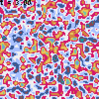 |
|4|2023-01-28|[ising](pyxel/ising) |Pyxel|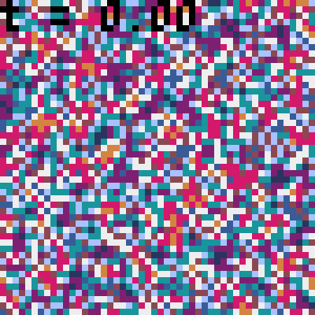 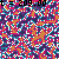 |

## Fractal

|No.|Date|Title|Platform|Content|
|---|----|----|---------|-------|
|1|2022-09-11|[mandelbrot](pyxel/mandelbrot) |Pyxel|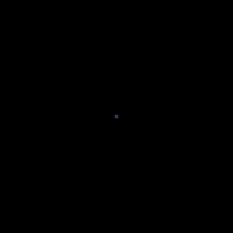 |
|2|2023-02-12|[koch](pyxel/koch) |Pyxel| |
|3|2023-03-12|[mira](pyxel/mira) |Pyxel| |
|4|2024-08-09|[julia](pyxel/julia) |Pyxel|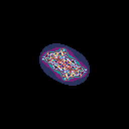  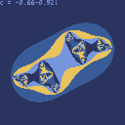 |

## Strange Attractor

|No.|Date|Title|Platform|Content|
|---|----|----|---------|-------|
|1|2023-04-11|[lorenz](pyxel/lorenz) |Pyxel| |
|2|2024-09-09|[thomas](pyxel/thomas) |Pyxel|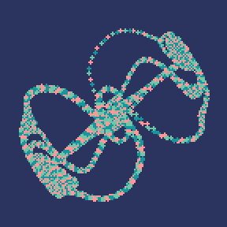   |
|3|2024-09-11|[dadras](pyxel/dadras) |Pyxel| |
|4|2024-09-12|[chen](pyxel/chen) |Pyxel| |
|5|2024-09-19|[halvorsen](pyxel/halvorsen) |Pyxel| |
|6|2024-09-20|[sprott](pyxel/sprott) |Pyxel| |
|7|2024-12-30|[lorenz83](pyxel/lorenz83) |Pyxel|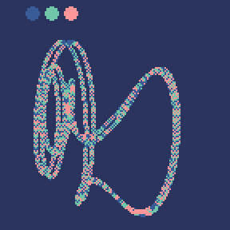 |
|8|2025-01-02|[rossler](pyxel/rossler) |Pyxel| |
|9|2025-01-03|[fourwing](pyxel/fourwing) |Pyxel|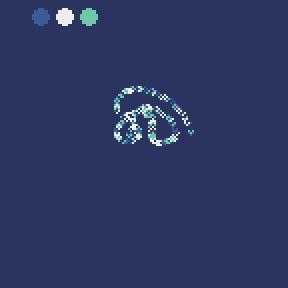 |
|10|2025-01-05|[threescroll](pyxel/threescroll) |Pyxel| |
|11|2025-10-31|[clifford](pyxel/clifford) |Pyxel|   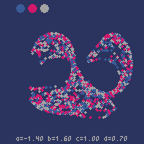|
|12|2025-11-22|[aizawa](pyxel/aizawa) |Pyxel|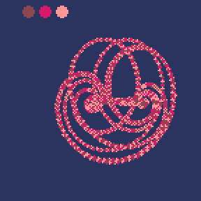 |
|13|2026-04-12|[simone](pyxel/simone) |Pyxel|  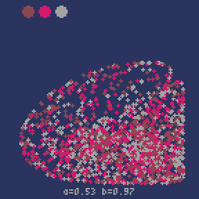 |

### Miscellaneous 

|No.|Date|Title|Platform|Content|
|---|----|----|---------|-------|
|1|2023-04-07|[toroid](pyxel/toroid) |Pyxel|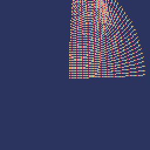 |
|2|2023-04-18|[singularity](pyxel/singularity) |Pyxel| |
|3|2024-07-12|[energy](pyxel/energy) |Pyxel| 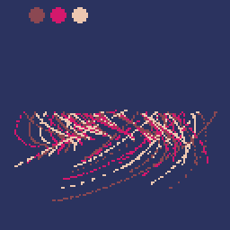|
|4|2024-07-26|[picotron](pyxel/picotron) |Pyxel| |
|5|2025-01-17|[boids](pyxel/boids) |Pyxel| |
|6|2025-04-22|[circle](pyxel/circle) |Pyxel| |
|7|2025-10-19|[box](pyxel/box) |Pyxel|   |
|8|2026-04-18|[dodeca](pyxel/dodeca) |Pyxel|   |
|9|2026-09-02|[sphere](pyxel/sphere) |Pyxel|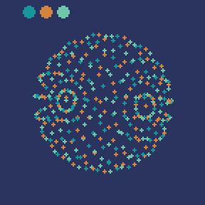   |
