## フラクタル芸術作品（2025年編）

### 2025-01-01

秋頃に，「ストレンジアトラクタ」の一種である「スプロットアトラクタ」を，Pyxel/Pythonで描きました．
Githubの方には，ソースコードを公開しましたが，Xには投稿していませんでした．
[リンク](https://kitao.github.io/pyxel/wasm/launcher/?run=jay-kumogata.FractalArts.pyxel.sprott.sprott)から，ブラウザでも動かせます．

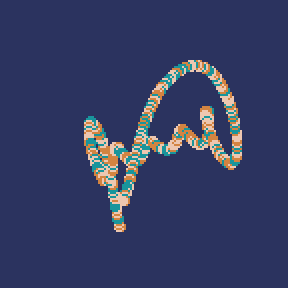

### 2025-01-02

「ストレンジアトラクタ」の一種である「レスラーアトラクタ」を，Pyxelで描いてみました．
GameBoy仕様を意識して，144x144ピクセル，4色縛りです．
[リンク](https://kitao.github.io/pyxel/wasm/launcher/?run=jay-kumogata.FractalArts.pyxel.rossler.rossler)から，ブラウザでも動かせます．

レスラーアトラクタの常微分方程式は，以下で示されます．

$\dfrac{dx}{dt} = -(y + z)$ 
$\dfrac{dy}{dt} = x + ay$ 
$\dfrac{dz}{dt} = b + z(x - c)$ 
$where \ a, \ b \ and \ c \ are \ constants.$ 

パラメータとしては，a = 0.2, b = 0.2, c = 5.7，初期条件としては，x = 10.0，y = 0.00，z = 10.0 を与えています．

### 2025-01-03

「ストレンジアトラクタ」の一種である「フォーウィングアトラクタ」を，Pyxelで描いてみました．
GameBoy仕様を意識して，144x144ピクセル，4色縛りです．
[リンク](https://kitao.github.io/pyxel/wasm/launcher/?run=jay-kumogata.FractalArts.pyxel.fourwing.fourwing)から，ブラウザでも動かせます．

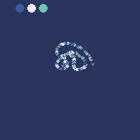

フォーウィングアトラクタの常微分方程式は，以下で示されます．

$\dfrac{dx}{dt} = ax + yz$ 
$\dfrac{dy}{dt} = bx + cy - xz$ 
$\dfrac{dz}{dt} = -z - xy$ 
$where \ a, \ b \ and \ c \ are \ constants.$ 

パラメータとしては，a = 0.2, b = 0.01, c = -0.4，初期条件としては，x = 1.3, y = -0.18, z = 0.01 を与えています．

### 2025-01-11

「ストレンジアトラクタ」の一種である「TSUCS(Three-Scroll Unified Chaotic System)アトラクタ」を，Pyxelで描いてみました．
GameBoy仕様を意識して，144x144ピクセル，4色縛りです．
[リンク](https://kitao.github.io/pyxel/wasm/launcher/?run=jay-kumogata.FractalArts.pyxel.threescroll.threescroll)から，ブラウザでも動かせます．

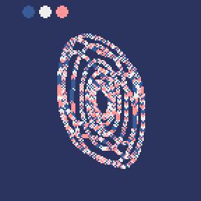

TSUCS(Three-Scroll Unified Chaotic System)アトラクタの常微分方程式は，以下で示されます．

$\dfrac{dx}{dt} = a ( y - x ) + dxz$ 
$\dfrac{dy}{dt} = bx - xz + fy$ 
$\dfrac{dz}{dt} = cz + xy - ex^2$ 
$where \ a, \ b, \ c, \ d, \ e \ and \ f \ are \ constants.$ 

パラメータとしては，a = 32.48, b = 45.84, c = 1.18, d = 0.13, e = 0.57, f = 14.7，初期条件としては，x = -0.29, y = -0.25, z = -0.59 を与えています．

### 2025-01-18

「ボイド(Boids)シミュレーション」を，Pyxelで描いてみました．
GameBoy仕様を意識して，144x144ピクセル，4色縛りです．
[リンク](https://kitao.github.io/pyxel/wasm/launcher/?run=jay-kumogata.FractalArts.pyxel.boids.boids&packages=numpy)から，ブラウザでも動かせます．

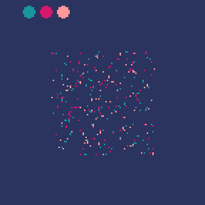

### 2025-04-20

SnowEsamosc氏作の「円の喧伝」のコードを，Grok3(beta)に食わせて，Pyxel/Pythonに変換してみました．
Grok君，Processingも読めるのですね．Processingのnoise()は，簡易Perlin法で模擬しています．
[リンク](https://kitao.github.io/pyxel/wasm/launcher/?run=jay-kumogata.FractalArts.pyxel.circle.circle)から，ブラウザでも動かせます．

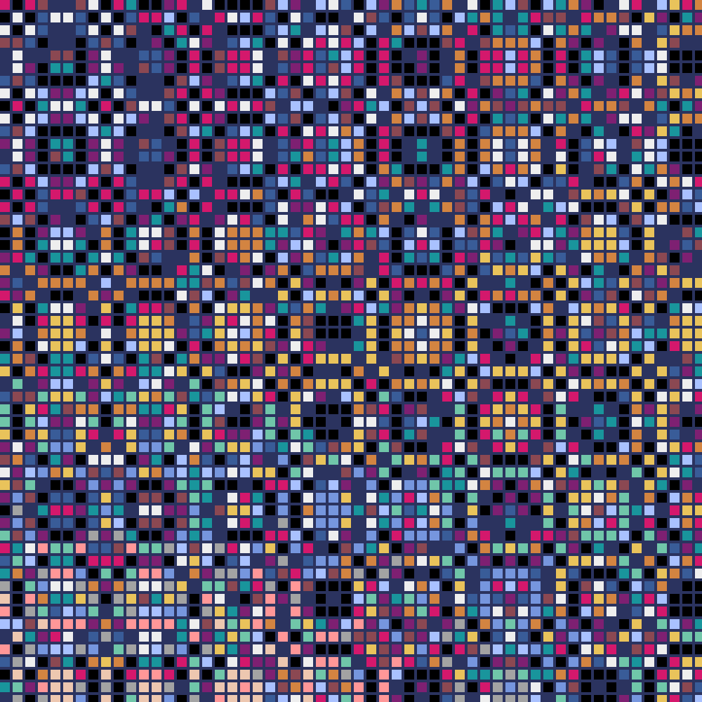

### 2025-04-24

Grok君の変換シリーズです．
少し前に，「円の喧伝」というProcessingデモを，Grok君で移植しました．

### 2025-10-18

ちょっと駄目だったので，もう一度やり直します．

### 2025-10-19

お彼岸の頃に，大昔に秋葉原のマイコンショップでデモしていた「ワイヤーフレーム」を想い出しました．
「[回転行列を使った3次元点群の回転](https://tech-deliberate-jiro.com/pcl-rot/)」という記事を見つけたので，Pyxelで表示させてみました．
立方体が回転するだけです．
[リンク](https://kitao.github.io/pyxel/wasm/launcher/?run=jay-kumogata.FractalArts.pyxel.box.box&packages=numpy)から動かせます．

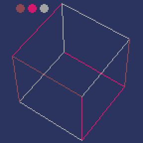
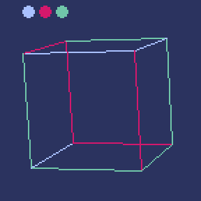

### 2025-10-22

[Clifford Attractor](https://x.com/jshguo/status/1980546634259038538)で遊んでみたけど，少し面白い．

### 2025-11-01

晩秋の頃に，「ストレンジアトラクタ」の一種である「クリフォードアトラクタ」を，Pyxel/Pythonで描きました．Githubの方には，ソースコードを公開しましたが，Xには投稿していませんでした．
[リンク](https://kitao.github.io/pyxel/wasm/launcher/?run=jay-kumogata.FractalArts.pyxel.clifford.clifford&packages=numpy)から，ブラウザでも動かせます．

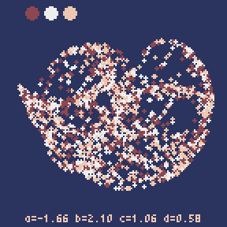
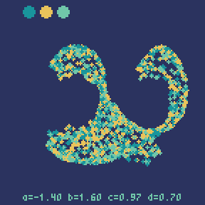
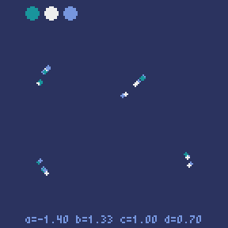
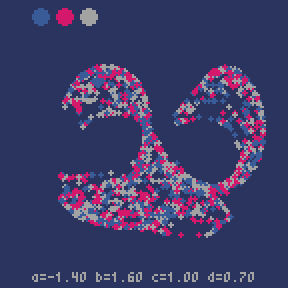

クリフォードアトラクタの常微分方程式は，以下で示されます．

$x_{n+1}=sin(ay_{n})+c \cdot cos(ax_{n})$ 
$y_{n+1}=sin(bx_{n})+d \cdot cos(by_{n})$ 
$where \ a, \ b, \ c \ and \ d \ are \ constants.$ 

パラメータとしては，a = -1.4, b = 1.6, c = 1.0, d = 0.7，初期条件としては，x = 0.0，y = 0.00，z = 0.0 を与えています．

### 2025-11-08

過去に描いた「トーマスアトラクタ」を，X軸/Y軸/Z軸で回転できるようにしてみました．ちなみに，「トーマスアトラクタ」は，ベルギーの科学者である René Thomas 氏により，1999年に提案されています．[リンク](https://kitao.github.io/pyxel/wasm/launcher/?run=jay-kumogata.FractalArts.pyxel.thomas.thomas&packages=numpy)から，ブラウザでも動かせます．

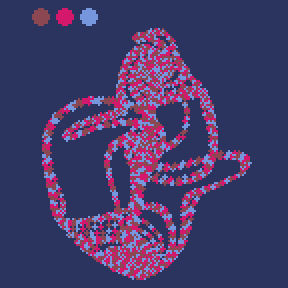
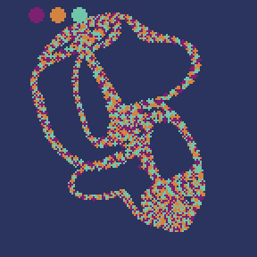

### 2025-11-20

昨日，どうしてもうまく描けなかった[Aizawa Attractor](https://x.com/abakcus/status/1992083983732207671)が描けるようになりました．
数式が間違ってたのかもしれません．特に見栄えはしないけど，そのうち出そうと思います．

### 2025-11-22

「ストレンジアトラクタ」の一種である「アイザワアトラクタ」を，Pyxelで描いてみました．
GameBoy仕様を意識して，144x144ピクセル，4色縛りです．
[リンク](https://kitao.github.io/pyxel/wasm/launcher/?run=jay-kumogata.FractalArts.pyxel.aizawa.aizawa)から，ブラウザでも動かせます．

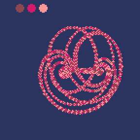

アイザワアトラクタの常微分方程式は，以下で示されます．

$\dfrac{dx}{dt} = ( z - b ) x - dy$ 
$\dfrac{dy}{dt} = dx + (z - b) y$ 
$\dfrac{dz}{dt} = c + az - \frac{z^3}{3} - (x^2+y^2)(1+ez)+fzx^3$ 
$where \ a, \ b, \ c, \ d, \ e \ and \ f \ are \ constants.$ 

パラメータとしては，a = 0.95, b = 0.7, c = 0.6, d = 3.5, e = 0.25, f = 0.1，初期条件としては，x = 0.1, y = 1.00, z = 0.01 を与えています．

### 2025-11-26

ストレンジアトラクタ(Strange Attractor)は，これで勢揃いしました．
ちなみに，アトラクタというのは，微分方程式を解き，時間を経過させた軌跡として描いた時に，その軌跡がある領域に引き寄せられる(Attract)状態のことです．
一番身近なアトラクターは，太陽系です．太陽と惑星の位置関係は，ニュートン力学の運動方程式(微分方程式)で与えられます．
この微分方程式を解くと，惑星は太陽に寄与せられて，その周りを廻ることが分かります．
このようなアトラクターを周期性アトラクターと呼びます．
そして，ある微分方程式の解は奇妙な軌跡を描くことが知られており，それがストレンジアトラクタと呼ばれているものになります．

### 2025-12-31

大晦日に，いくつかBoxデモ (
[[1]](https://x.com/KooKiz/status/2006009274032427331), 
[[2]](https://x.com/saraiva_neves/status/2005672244404707700),
[[3]](https://x.com/KooKiz/status/2006104483668140531)
) を発見しました．

以上
