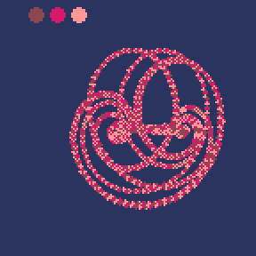

# Aizawa Attractor

## Introduction

I drew the Aizawa attractor with Pyxel/Python.

 

## How to Run

Please execute the following from the Pyxel (version 2.5.9) environment.
Or you can play [here](https://kitao.github.io/pyxel/wasm/launcher/?run=jay-kumogata.FractalArts.pyxel.aizawa.aizawa).

	> python aizawa.py

