# Gray-Scott Model

## Introduction

Gray-Scott model is a kind of reaction-diffusion system. Various patterns appear by changing the initial parameters.

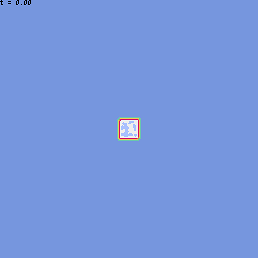 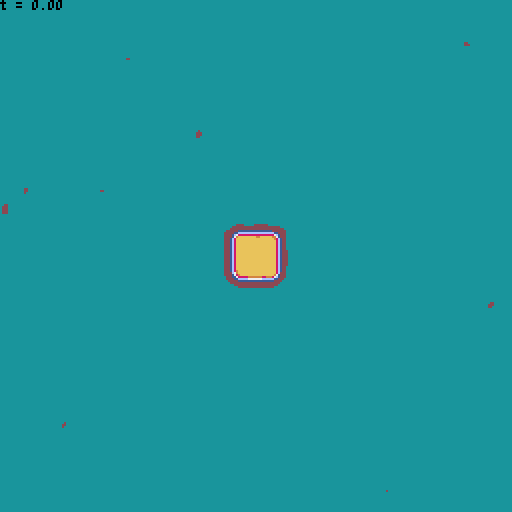 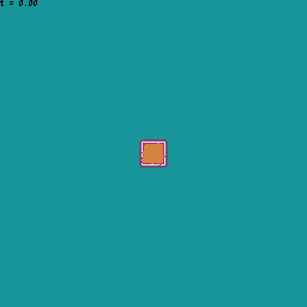 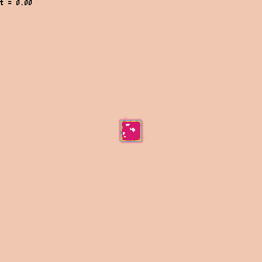 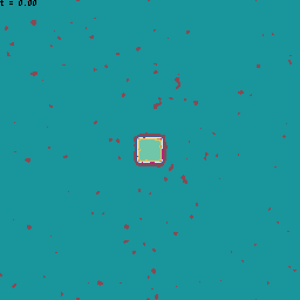 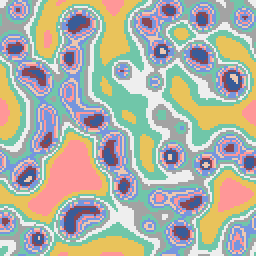 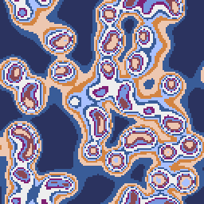 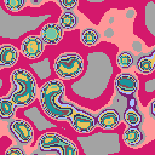 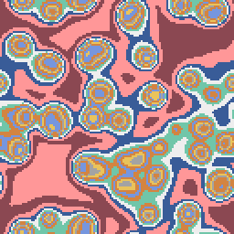 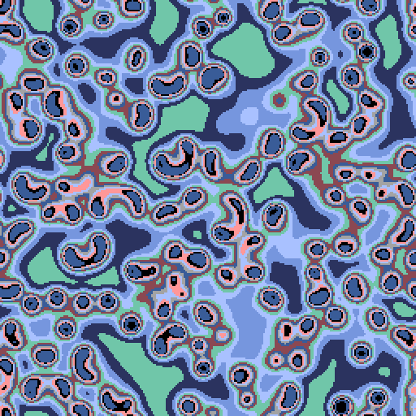  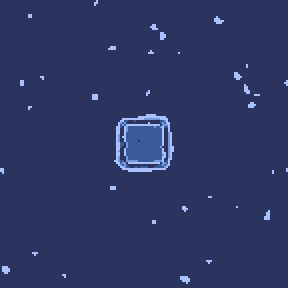 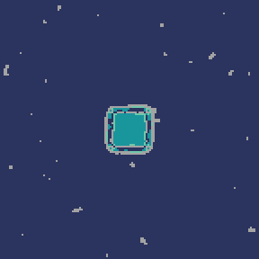 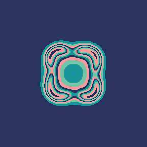 

## How to Run

Please execute the following from the Pyxel (version 1.7.0) environment.
Or you can play [here](https://kitao.github.io/pyxel/wasm/launcher/?run=jay-kumogata.FractalArts.pyxel.grayscott.grayscott&packages=numpy).

	> python grayscott.py
