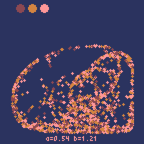
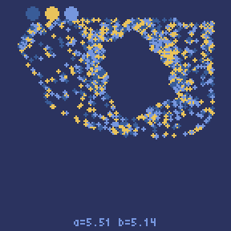
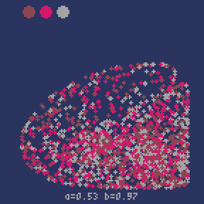

# Simone Attractor

## Introduction

I drew the Simone attractor with Pyxel/Python.

  

## How to Run

Please execute the following from the Pyxel (version 2.5.13) environment.
Or you can play [here](https://kitao.github.io/pyxel/wasm/launcher/?run=jay-kumogata.FractalArts.pyxel.simone.simone&packages=numpy).

	> python simone.py

## How to Control

- [RIGHT]/[LEFT]: Increase/Decrease the parameter 'a'
- [DOWN]/[UP]: Increase/Decrease the parameter 'b'

## Remarks

