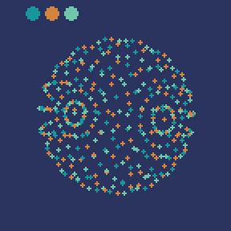
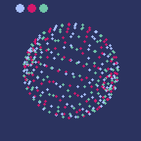

# Sphere demo for Pyxel/Python

## Introduction

It is a Sphere demo.

 

## How to Play

Please execute the following from the Pyxel (version 2.2.10) environment.
Or you can play [here](https://kitao.github.io/pyxel/wasm/launcher/?run=jay-kumogata.FractalArts.pyxel.sphere.sphere&packages=numpy).

	> python sphere.py

## How to Control

- [LEFT]/[RIGHT]: Rotate on the X axis (negative/positive direction)
- [UP]/[DOWN]: Rotate on the Y axis (negative/positive direction)
- [Z]/[X]: Rotate on the Z axis (negative/positive direction)

## Remarks
